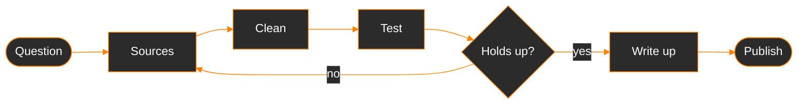

  

  

  
  

### Overview

I work where data, research and software meet. Each project starts with a question worth answering, gets built on official data and proper statistical testing, and ends as something people can actually open and use, whether that is a written study, a clean dataset or a live interactive site. The topics change from one project to the next, the standards don't.

### Capabilities

<table>
  <tr>
    <td width="33%" valign="top">
      <h4>🧭 Research</h4>
      Framing questions that can be tested 
      Correlation and significance testing 
      Method notes anyone can follow 
      Findings stated with their limits
    </td>
    <td width="33%" valign="top">
      <h4>🗄️ Data</h4>
      Collection from APIs and official releases 
      Raw to clean pipelines, raw never edited 
      Validation and consistency checks 
      Manual refresh routines with change checks
    </td>
    <td width="33%" valign="top">
      <h4>⚙️ Engineering</h4>
      Python for analysis, JavaScript for the web 
      Static sites deployed on Cloudflare Pages 
      Isolated environments per project 
      Git workflows with a clean history
    </td>
  </tr>
</table>

### Workflow

### Standards

| | Standard | In practice |
|:-:|:--|:--|
| 🔁 | **Reproducible** | Every study runs in its own environment from scripted steps, so the results can be rebuilt from scratch |
| 🔗 | **Traceable** | Raw files stay untouched and every figure can be followed back to its original source |
| ⚖️ | **Neutral** | Results are reported as they come out, with the method and its limits shown next to them |
| 🚀 | **Shipped** | Work ends as something usable, not as a notebook sitting on a drive |

### Stack

  
  
  
  
  
  
   
  
  
  
  

### Telemetry

  <picture>
    <source media="(prefers-color-scheme: dark)" srcset="https://github-readme-stats.vercel.app/api?username=t4zc4t&show_icons=true&hide_border=true&bg_color=1a1a1a&title_color=FF8000&icon_color=FF8000&text_color=e6e6e6&ring_color=FF8000&rank_icon=github&custom_title=Foraxsys&hide=stars%2Cissues%2Ccontribs">
    
  </picture>
  <picture>
    <source media="(prefers-color-scheme: dark)" srcset="https://github-readme-stats.vercel.app/api/top-langs/?username=t4zc4t&layout=compact&hide_border=true&bg_color=1a1a1a&title_color=FF8000&text_color=e6e6e6">
    
  </picture>

  <picture>
    <source media="(prefers-color-scheme: dark)" srcset="https://streak-stats.demolab.com?user=t4zc4t&hide_border=true&background=1a1a1a&ring=FF8000&fire=FF8000&currStreakNum=FF8000&sideNums=e6e6e6&currStreakLabel=FF8000&sideLabels=e6e6e6&dates=8a8a8a&stroke=333333">
    
  </picture>

  <picture>
    <source media="(prefers-color-scheme: dark)" srcset="https://raw.githubusercontent.com/t4zc4t/t4zc4t/output/snake-dark.svg">
    
  </picture>

<picture>
  <source media="(prefers-color-scheme: dark)" srcset="https://capsule-render.vercel.app/api?type=waving&color=0:FF8000,40:FF8000,100:111111&height=110&section=footer">
  
</picture>
