  <picture>
    <source media="(prefers-color-scheme: dark)" srcset="assets/banner-mafia.svg">
    
  </picture>

  <picture>
    <source media="(prefers-color-scheme: dark)" srcset="https://readme-typing-svg.demolab.com?font=Noto+Serif+JP&weight=500&size=18&duration=3400&pause=1000&color=D7263D&center=true&vCenter=true&width=560&lines=Applied+research+%C2%B7+official+data;Raw+source+%E2%86%92+tested+result;Reproducible+by+design;Studies+%C2%B7+datasets+%C2%B7+live+sites">
    
  </picture>

  
  

  Data, research and software, in one workflow 
  Official sources → statistical testing → usable output 
  Studies, datasets and live sites across varied topics

<table>
  <tr>
    <td width="33%" valign="top">
      <h4>研究 · Research</h4>
      Testable research questions 
      Correlation and significance tests 
      Transparent method notes 
      Findings with stated limits
    </td>
    <td width="33%" valign="top">
      <h4>資料 · Data</h4>
      APIs and official releases 
      Raw → clean pipelines 
      Validation and consistency checks 
      Change-checked refreshes
    </td>
    <td width="33%" valign="top">
      <h4>技術 · Engineering</h4>
      Python analysis, JavaScript web 
      Static sites on Cloudflare Pages 
      Isolated project environments 
      Clean Git history
    </td>
  </tr>
</table>

  <picture>
    <source media="(prefers-color-scheme: dark)" srcset="assets/workflow-mafia.svg">
    
  </picture>

| | Standard | In practice |
|:-:|:--|:--|
| 再&#8288;現 | **Reproducible** | Scripted steps, isolated environments, rebuildable results |
| 追&#8288;跡 | **Traceable** | Untouched raw files, every figure source-linked |
| 中&#8288;立 | **Neutral** | Results as found, methods and limits alongside |
| 完&#8288;遂 | **Shipped** | Usable outputs, not idle notebooks |

  
  
  
  
  
  
   
  
  
  
  

  <picture>
    <source media="(prefers-color-scheme: dark)" srcset="https://github-readme-stats.vercel.app/api?username=t4zc4t&show_icons=true&hide_border=true&bg_color=0f0c0c&title_color=D7263D&icon_color=C8A97E&text_color=E8DFCF&ring_color=D7263D&rank_icon=github&custom_title=Foraxsys&hide=stars%2Cissues%2Ccontribs">
    
  </picture>
  <picture>
    <source media="(prefers-color-scheme: dark)" srcset="https://github-readme-stats.vercel.app/api/top-langs/?username=t4zc4t&layout=compact&hide_border=true&bg_color=0f0c0c&title_color=D7263D&text_color=E8DFCF">
    
  </picture>

  <picture>
    <source media="(prefers-color-scheme: dark)" srcset="https://streak-stats.demolab.com?user=t4zc4t&hide_border=true&background=0f0c0c&ring=D7263D&fire=D7263D&currStreakNum=D7263D&sideNums=E8DFCF&currStreakLabel=C8A97E&sideLabels=E8DFCF&dates=9C8B74&stroke=2a1f1f">
    
  </picture>

  <picture>
    <source media="(prefers-color-scheme: dark)" srcset="https://raw.githubusercontent.com/t4zc4t/t4zc4t/output/snake-dark.svg">
    
  </picture>

<picture>
  <source media="(prefers-color-scheme: dark)" srcset="https://capsule-render.vercel.app/api?type=waving&color=0:0B0909%2C55:4E0910%2C100:C8283C&height=110&section=footer">
  
</picture>
