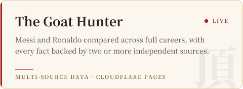
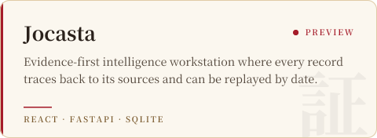
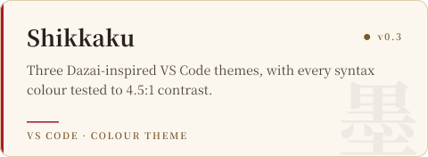

  <picture>
    <source media="(prefers-color-scheme: dark)" srcset="assets/banner-mafia.svg">
    
  </picture>

  <b>Research-driven developer building open studies, live data platforms and developer tools.</b>

  
  
  
  

I turn open questions into reproducible studies, and studies into platforms that keep themselves current. Every project starts from official data, publishes its method and sources alongside the code, and ends as something people can open and use.

Currently building **Jocasta**, an intelligence workstation where every record traces back to the evidence behind it.

  <a href="https://github.com/t4zc4t/parc-ferme"><picture><source media="(prefers-color-scheme: dark)" srcset="assets/cards/parc-ferme-mafia.svg"></picture></a>
  <a href="https://the-goat-hunter.pages.dev"><picture><source media="(prefers-color-scheme: dark)" srcset="assets/cards/the-goat-hunter-mafia.svg"></picture></a>
  <a href="https://github.com/t4zc4t/Jocasta"><picture><source media="(prefers-color-scheme: dark)" srcset="assets/cards/jocasta-mafia.svg"></picture></a>
  <a href="https://github.com/t4zc4t/market-study"><picture><source media="(prefers-color-scheme: dark)" srcset="assets/cards/market-study-mafia.svg"></picture></a>
  <a href="https://github.com/t4zc4t/Shikkaku"><picture><source media="(prefers-color-scheme: dark)" srcset="assets/cards/shikkaku-mafia.svg"></picture></a>
  <a href="https://github.com/t4zc4t/texz"><picture><source media="(prefers-color-scheme: dark)" srcset="assets/cards/texz-mafia.svg"></picture></a>

| Study | Question | Data |
|:--|:--|:--|
| [Monsoon and the Indian Economy](https://github.com/t4zc4t/monsoon-economy-study) | How much does a weak monsoon still cost in farm output, growth and food prices, and how does policy respond? | IMD, MoSPI, RBI |
| [Indian Sugar Case Study](https://github.com/t4zc4t/indian-sugar-case-study) | Has ethanol diversion helped mills clear cane dues to farmers faster? | Parliament records, company annual reports |
| [Indian Economy, 2000 to 2025](https://github.com/t4zc4t/indian-economy-study) | How did growth, inflation, FDI and reserves move over 25 years? | World Bank |

| | |
|:--|:--|
| **Languages** |     |
| **Data** |      |
| **Web** |     |
| **Delivery** |     |

  <picture>
    <source media="(prefers-color-scheme: dark)" srcset="https://raw.githubusercontent.com/t4zc4t/t4zc4t/output/activity-dark.svg">
    
  </picture>

  <picture>
    <source media="(prefers-color-scheme: dark)" srcset="https://raw.githubusercontent.com/t4zc4t/t4zc4t/output/snake-dark.svg">
    
  </picture>

Issues and pull requests are welcome on any repository.

<picture>
  <source media="(prefers-color-scheme: dark)" srcset="https://capsule-render.vercel.app/api?type=waving&color=0:0B0909%2C55:4E0910%2C100:C8283C&height=110&section=footer">
  
</picture>
